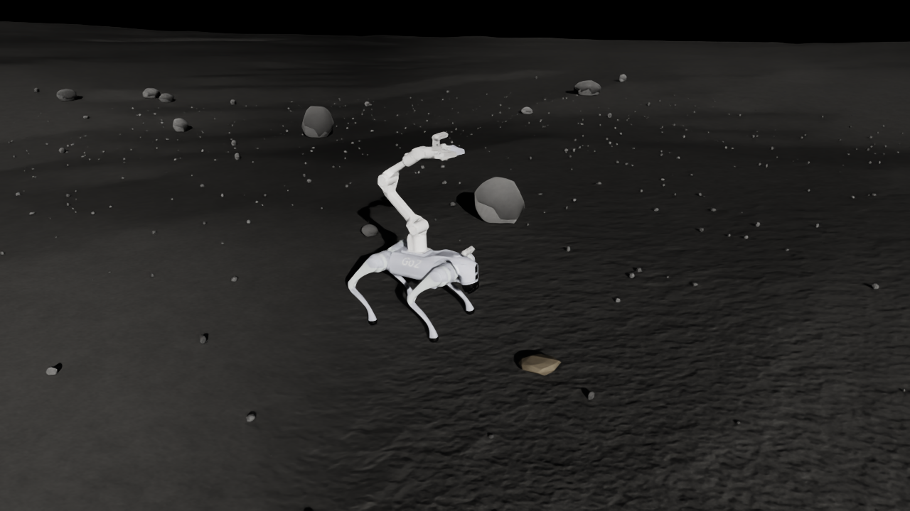

# Go2Piper_Lunar

面向月球表面 **Go2 + Piper + D435 重载矿石抓取**的 Isaac Sim 5.1.0 工程，后续研究重点是整体姿态优化与 WBC，提高满足支撑、摩擦、关节力矩和夹持约束时的可抓取质量上限。

| 环境 | 地形与用途 | 配置 |
| --- | --- | --- |
| **Lunar_baseline** | 保留原有程序化地形、中心平面与散石，作为可控实验基线 | [Lunar_baseline.json](env/config/Lunar_baseline.json) |
| **Lunar** | Apollo 17 着陆区 LROC 实测 DEM 驱动；保留天然起伏，补充明确标注的合成月壤细节 | [Lunar.json](env/config/Lunar.json) |

从仓库根目录运行：

```bash
# 真实数据环境（默认暂停，点击 Play 可运行关节 PD）
bash env/run.sh --env Lunar

# 原有可控基线
bash env/run.sh --env Lunar_baseline

# 独立配置附加坡度、足地静/动摩擦、矿石质量
bash env/run.sh --env Lunar --slope-deg 5 \
  --foot-static-friction 0.6 --foot-dynamic-friction 0.5 \
  --mass-kg 5 --simulate
```

不传 `--env` 时默认打开 `Lunar`。参数变体自动保存为独立场景，保留两个默认环境。对 `Lunar`，`--slope-deg 0` 保留天然坡度；非零值在 DEM 高程上叠加 `x × tan(角度)`。足地摩擦参数直接表示接触对的有效系数。

也可以在 Isaac Sim 的 File → Open 中打开 [Lunar.usda](env/generated/Lunar.usda) 或 [Lunar_baseline.usda](env/generated/Lunar_baseline.usda)。视口相机选择 `/World/Cameras/Close` 或 `/World/Cameras/Overview`。



- [环境说明、参数与重建方法](env/README.md)
- [真实数据来源、处理与论文引用](assets/terrain_data/apollo17/README.md)
- [Lunar 场景清单](env/generated/Lunar.manifest.json)
- [本次验证记录](env/reports/ENVIRONMENTS_VALIDATION.md)
- [机器人原始资产说明](assets/go2_piper_d435_assets/README.md)

两个场景均使用浮动基座、受力矩限制的关节 PD、动态目标矿石与理想 RGB-D 相机。当前地面采用刚性接触；已接入下述 Deep WBC 学习训练任务；传统 QP WBC、抓取执行、最大载荷搜索和月壤变形模型尚待接入。Gazebo 格式保留在源资产包中，本工程启动入口使用 Isaac Sim。

## 移动与末端位置轨迹跟踪训练

已迁移 third_party 中 Deep-Whole-Body-Control 的训练后端到 **Isaac Sim 5.1.0 + Isaac Lab 2.3.2**，注册任务 **Go2_Piper_Lunar_Tracking**。统一策略输出 Go2 的 12 个腿关节与 Piper 的 6 个臂关节动作，保留原双头 PPO 和历史编码器，默认训练场景为 Lunar 的实测地形局部裁剪。

```bash
bash scripts/train.sh --headless --num-envs 64 --iterations 10000
bash scripts/train.sh --mode validate --headless --num-envs 2 --steps 120
bash scripts/play.sh --checkpoint outputs/validation/resume/model_24.pt --num-envs 1 --steps 1200
```

- [训练配置](configs/training/Go2_Piper_Lunar_Tracking.json)
- [迁移说明、训练/恢复/回放、观测与奖励定义](third_party/Deep-Whole-Body-Control/isaaclab/README.md)
- [训练链路验证记录](docs/TRAINING_VALIDATION.md)

当前交付的是可运行的学习框架与短程验证模型。验证模型未收敛，不能作为移动/抓取性能结果；当前任务使用仿真状态，不使用 D435 图像，矿石未附着在机械臂上。
