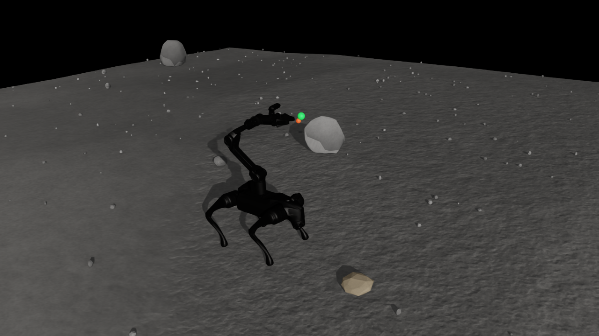

# Go2_Piper_Lunar_Tracking 迁移验证

日期：2026-10-28。运行环境：Isaac Sim 5.1.0.0、Isaac Lab 2.3.2（Python distribution 0.54.2）、Python 3.11.15、PyTorch 2.7.0+cu128、RTX 3090 Ti。

本记录证明训练环境和学习链路可运行，不证明策略已经收敛，也不代表重载抓取能力。测试时 GPU 同时运行用户原有的两个计算进程；未中断这些进程。

## 结果

| 检查 | 实测结果 |
| --- | --- |
| 新后端 CPU 单元测试 | 6 项通过；包含四元数、连续轨迹速度、三角面高度、配置协议、双头 PPO、历史编码器更新、超时 bootstrap |
| 原月面环境回归测试 | 11 项通过 |
| Lunar 仿真 | 2 个环境 × 120 个策略步；局部超时重置通过；USD 无缺失依赖；裁剪高程顶点与原场景完全一致 |
| Lunar_baseline 仿真 | 同上 |
| Lunar 参数变体 | 附加 5° 坡度、足地 μs=0.6 / μd=0.5、矿石 5 kg，全部配置与运行检查通过 |
| 月球重力 | 三种场景的动态矿石自由落体均测得约 1.61999965 m/s² |
| 控制协议 | 20 个物理关节，18 个策略动作，919 维观测；关节名称顺序及真实 PhysX 力矩上限校验通过 |
| 短程训练 | 4 环境，22 轮，2,816 条转移，21 次 PPO 更新 + 1 次历史编码器更新；参数 L1 变化量 992.663，数值有限 |
| 检查点恢复 | 从第 22 轮继续到 24 轮；两个优化器、算法计数与课程进度恢复；参数继续更新 |
| 默认规模 | 64 环境，默认 rollout=48、epochs=5，完成 2 轮 PPO、6,144 条转移；参数更新且数值有限 |
| 策略回放 | 加载第 24 轮模型，历史编码器推理通过；120 步无 NaN，随后完成 60 步带图像回放 |
| 渲染 | 月面裁剪、Go2 + Piper、矿石、绿色目标 TCP 和红色实际 TCP 均已人工检查 |
| 原入口兼容 | 原路径 train.py 完成恢复训练；play.py 完成历史策略回放 |

64 环境的两轮端到端吞吐约为 389 和 452 transitions/s，是在共享 GPU 上的短测结果，不是专用设备性能基准。

## 证据位置

- `outputs/validation/unit_tests.txt`
- `outputs/validation/Lunar/validation.json`
- `outputs/validation/Lunar_baseline/validation.json`
- `outputs/validation/Lunar_variant/validation.json`
- `outputs/validation/training/metrics.jsonl` 与 `training_result.json`
- `outputs/validation/resume/model_24.pt` 与 `training_result.json`
- `outputs/validation/batch64/metrics.jsonl` 与 `training_result.json`
- `outputs/validation/play_verified/play.json` 与 `scene.png`
- 每个成功运行目录下的 `run.json`：参数、软件版本、代码 SHA256、地形来源、模型限力、物理后端。

回放图：



图中只包含训练用局部裁剪；黑色背景是没有大范围远景的天空/裁剪外区域。完整 Lunar 场景仍由原环境入口展示。

## 复现

从仓库根目录运行：

```bash
bash scripts/train.sh --mode validate --headless --num-envs 2 --steps 120
bash scripts/train.sh --mode validate --headless --num-envs 2 --steps 120 --env Lunar_baseline
bash scripts/train.sh --mode validate --headless --num-envs 2 --steps 120 \
  --slope-deg 5 --foot-static-friction 0.6 --foot-dynamic-friction 0.5 --mass-kg 5

bash scripts/train.sh --headless --num-envs 4 --iterations 22 \
  --steps-per-env 32 --epochs 2 --episode-seconds 4 --log-dir outputs/recheck_train
bash scripts/train.sh --headless --checkpoint outputs/recheck_train/model_22.pt \
  --iterations 2 --log-dir outputs/recheck_resume

bash scripts/play.sh --checkpoint outputs/recheck_resume/model_24.pt --num-envs 1 --steps 1200
```

## 已知范围

当前采用真值状态、固定物理参数、重复的月面局部区域和关节 PD。GPU 模式显式关闭不受支持的 CCD，以 240 Hz 离散接触运行。六维特权环境参数目前不做逐环境动力学随机化。末端目标使用随基座 XY 与航向移动的水平坐标系，TCP 偏置需要按实物标定。矿石质量可配，但未附着或抓取；改矿石质量不能代表机械臂带载训练。

源论文中的统一策略结构被保留，但机器人、月球重力、地形、控制幅度、观测和奖励按本任务重新定义。旧 WidowGo1 检查点与此任务不兼容。正式实验应重新训练，并在完整课程范围、独立种子和地形/摩擦条件下评估。
