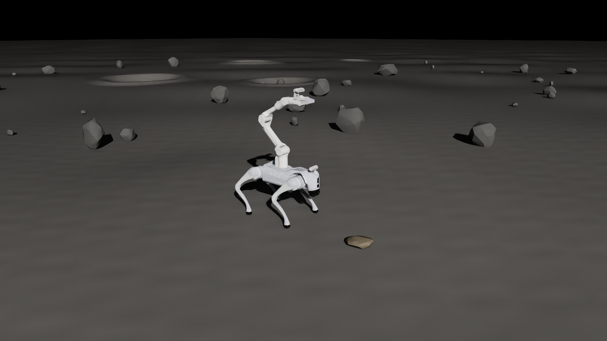
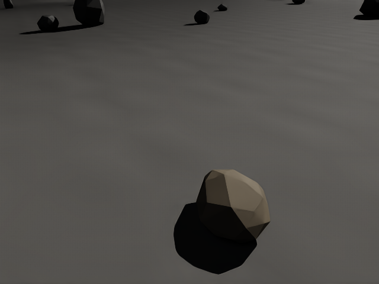

# 本机验收记录

日期：2026-10-22。环境：Isaac Sim 5.1.0（安装包标识 `5.1.0-rc.19+release.26219.9c81211b.gl`）、Python 3.11.15、RTX 3090 Ti、NVIDIA 580.178.04。结果对应本目录中的配置、场景清单与 JSON 报告。

## 已完成

| 检查 | 结果 |
| --- | --- |
| 原始资产完整性 | 115 个文件哈希通过，291 处本地资源引用可解析；原始 USD SHA-256 与来源包一致 |
| 数值测试 | 5 项 unittest 通过：平整区/坡度、地形复现和法向、闭合矿石、已知长方体惯量及质量/平移一致性、无效参数/关节限位 |
| 默认场景结构 | 25 个机器人刚体、20 个活动关节、1 个浮动 articulation root；无连接世界的固定关节 |
| 模型限制 | 20 个 Drive 的最大力/力矩与原资产关节元数据一致 |
| 相机坐标 | 两台 USD Camera 的前向与资产 ROS 光学坐标的 +Z 对齐，光心位置一致 |
| 资源闭包与搬移 | 默认场景和 5 kg 场景各有 4 个 USD layer，未解析资源为 0；复制全部运行依赖至临时目录后可独立打开 |
| 矿石质量覆盖 | 5 kg 示例保留相同几何，三个主惯量均为默认 2 kg 的 2.5 倍 |
| GUI 启动 | 从 `/tmp` 工作目录调用仓库启动脚本，成功打开 GUI、渲染并退出 |
| 默认动态场景 | 1200 个物理步、5 秒仿真，验证通过 |
| 5 kg 独立矿石示例 | 同样完成 1200 步动态检查；矿石落地、机器人空载站立通过，未抓取 |
| RGB-D | 两台相机均成功输出 RGB 与 float32 光学 Z 深度 |

## 默认场景动态结果

来源：[default/simulation.json](default/simulation.json)、[default/capture.json](default/capture.json)。

- 自由落体测得重力：`1.6200003028 m/s²`。
- 基座最大倾角：`0.510989°`；结束高度：`0.321244 m`。
- 四足末段平均竖直支撑力（FL、FR、RL、RR）：`8.0230、8.2698、7.1443、7.0925 N`。
- 支撑力总和：`30.52967 N`；源机器人质量对应的月面重量：`18.845413 × 1.62 = 30.52957 N`。
- 目标矿石结束速度约 `1.83e-5 m/s`，已落地稳定。
- 头部深度有效比例 `100%`，腕部约 `73.28%`；腕部部分像素朝向远景/天空，有效比例不要求 100%。





## 复现命令

```bash
# 默认动态场景与两台传感器
bash env/run.sh --headless --simulate --steps 1200 --validate \
  --capture env/reports/default --sensors

# USD 结构、相机光轴、驱动力限制与资源搬移
~/anaconda3/envs/isaaclab/bin/python env/validate_scene.py \
  --scene env/generated/lunar_scene.usda env/generated/lunar_mass_5kg.usda

# 资产与数值检查
~/anaconda3/envs/isaaclab/bin/python assets/go2_piper_d435_assets/validate.py
~/anaconda3/envs/isaaclab/bin/python -m unittest discover -s env/tests -v
```

5 kg 场景运行结果见 [mass5/simulation.json](mass5/simulation.json)。结构检查详见 [structure.json](structure.json)，生成参数详见 [默认场景清单](../generated/lunar_scene.manifest.json)。

本次验收覆盖场景加载、显示、重力、站姿、接触和理想相机输出。矿石始终是地面上的独立对象；未执行抓取或提升矿石，也未验证任何载荷上限。当前 PD 是场景检查用基线，WBC 和重载抓取实验需要后续接入。
